# 💈 Telegram-бот для онлайн-записи в барбершоп

Бот, через который клиенты записываются на услуги салона: выбирают услугу, мастера, день в календаре и свободное время. После визита бот сам просит оценку, а администратор управляет расписанием, услугами и мастерами прямо в Telegram и выгружает отчёты в Excel.

> Демонстрационный проект. Легко адаптируется под салон красоты, маникюр, автосервис, репетитора, клинику — любой бизнес с записью по времени.


<h3 align="center">Запись клиента</h3>
<p align="center">
  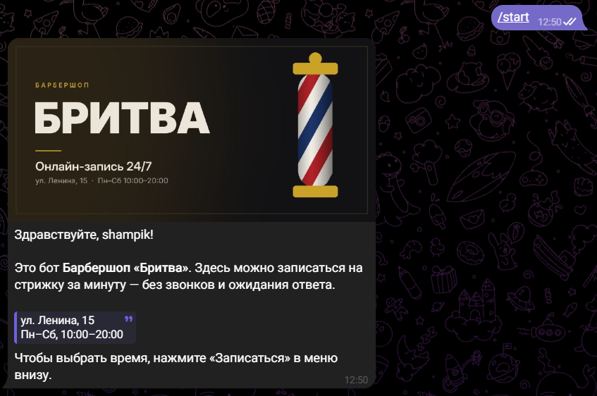
  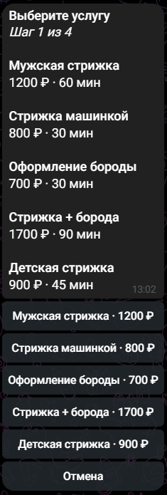
  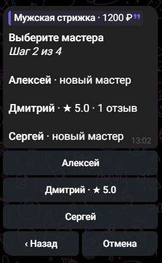
</p>
<p align="center">
  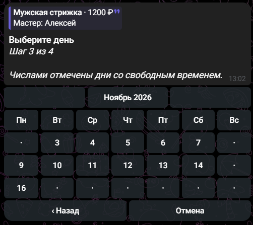
  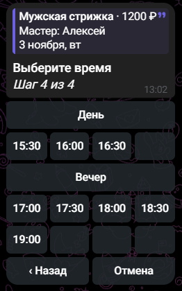
  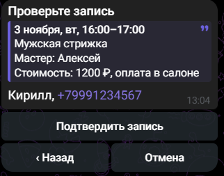
</p>
<p align="center">
  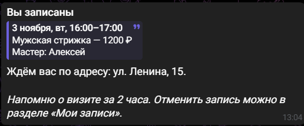
  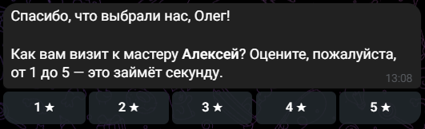
</p>

<h3 align="center">Админ-панель</h3>
<p align="center">
  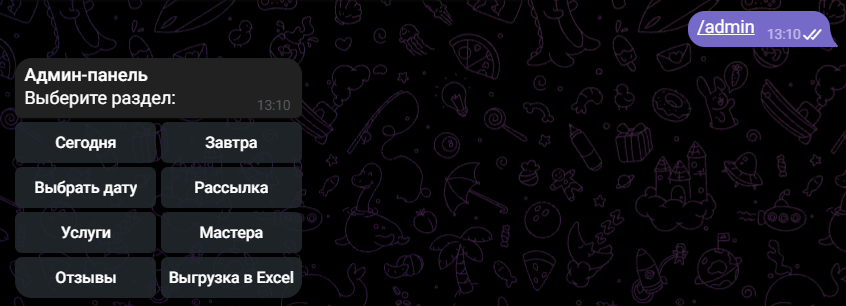
  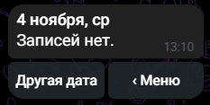
  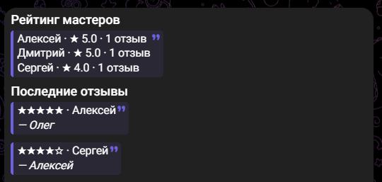
</p>
<p align="center">
  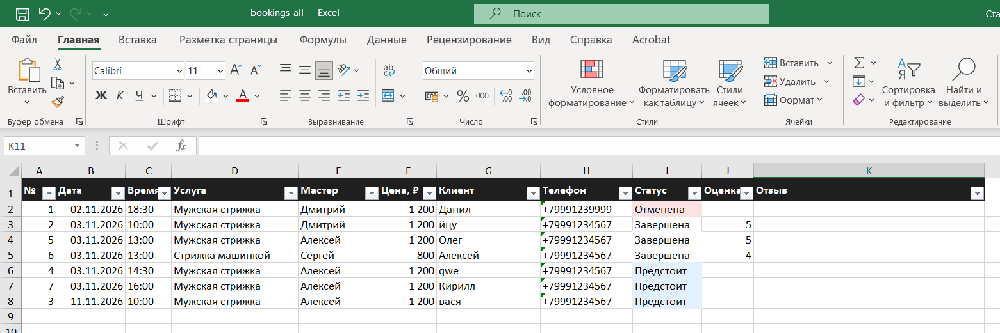
</p>

## Возможности

**Для клиента**
- Приветствие с фирменным баннером
- Пошаговая запись с индикатором прогресса: услуга → мастер → день → время → имя и телефон → подтверждение
- Описания услуг и мастеров, рейтинг мастеров по отзывам
- Календарь на месяц с листанием: видны только дни со свободными окнами
- Время сгруппировано на утро, день и вечер; учитываются длительность услуги и уже занятое время
- Кнопка «Назад» на каждом шаге, отправка номера телефона одной кнопкой
- Раздел «Мои записи» с отменой
- Напоминание за 2 часа до визита
- Запрос оценки 1–5 и комментария после визита

**Для администратора** (`/admin`)
- Мгновенные уведомления о новых записях, отменах и отзывах
- Расписание на сегодня, завтра или любую дату с суммой выручки за день
- Отмена записи с автоматическим уведомлением клиента
- Управление услугами: добавить, изменить цену, скрыть
- Управление мастерами: добавить, скрыть (текущие записи сохраняются)
- Рейтинг мастеров и последние отзывы
- Выгрузка в Excel за текущий месяц, прошлый месяц или всё время: все записи со статусами и отзывами + сводка по мастерам (записи, выручка, средняя оценка)
- Рассылка сообщений всем пользователям бота

**Надёжность**
- Защита от двойного бронирования: если два клиента одновременно выбрали одно время, запишется только первый, второму бот предложит другое
- Цена фиксируется в момент записи: изменение прайса не искажает старые отчёты
- Автоматическое обновление структуры базы при выходе новой версии — данные не теряются
- Валидация имени, телефона и всех полей админки

## Стек

- Python 3.10+
- [aiogram 3](https://docs.aiogram.dev/) — асинхронный фреймворк для Telegram-ботов
- SQLite + aiosqlite
- openpyxl — генерация Excel-отчётов
- FSM (конечный автомат) для пошаговых сценариев

## Запуск

1. Создайте бота у [@BotFather](https://t.me/BotFather) и получите токен.
2. Узнайте свой Telegram id у [@userinfobot](https://t.me/userinfobot).
3. Установите зависимости и настройте окружение:

```bash
git clone <ссылка-на-репозиторий>
cd booking_bot
python -m venv venv
venv\Scripts\activate          # Windows
# source venv/bin/activate     # Linux / macOS
pip install -r requirements.txt
copy .env.example .env         # Windows (Linux/macOS: cp .env.example .env)
```

4. Впишите в `.env` токен и свой id в `ADMIN_IDS`.
5. Запустите:

```bash
python main.py
```

6. Напишите боту `/start`, а для админ-панели — `/admin`.

## Настройка под заказчика

Основное лежит в `settings.py`:

| Что | Где |
|---|---|
| Название, адрес, телефон | `SALON_NAME`, `SALON_ADDRESS`, `SALON_PHONE` |
| Картинка приветствия | `assets/welcome.jpg` |
| Часы и дни работы | `WORK_START`, `WORK_END`, `WORK_DAYS` |
| Шаг сетки времени | `SLOT_STEP_MIN` |
| На сколько дней вперёд запись | `DAYS_AHEAD` |
| Когда напоминать и просить отзыв | `REMIND_BEFORE_HOURS`, `REVIEW_AFTER_MIN` |
| Стартовые услуги и мастера | `DEFAULT_SERVICES`, `DEFAULT_MASTERS` |

Услуги и мастера заносятся в базу при первом запуске, дальше ими удобно управлять из админ-панели.

## Структура проекта

```
booking_bot/
├── main.py              # запуск бота
├── config.py            # загрузка .env
├── settings.py          # настройки салона
├── database.py          # работа с SQLite и миграции
├── keyboards.py         # кнопки, календарь, callback-данные
├── states.py            # состояния FSM
├── filters.py           # фильтр «только для админов»
├── assets/
│   └── welcome.jpg      # баннер приветствия
├── handlers/
│   ├── user.py          # сценарий клиента и отзывы
│   └── admin.py         # админ-панель
└── utils/
    ├── schedule.py      # расчёт свободного времени
    ├── formatting.py    # форматирование дат, телефонов, записей
    ├── export.py        # выгрузка в Excel
    ├── notify.py        # уведомления администраторам
    └── reminders.py     # напоминания и запросы отзывов
```

## Возможные доработки

- Выходные и отпуска мастеров, индивидуальный график
- Онлайн-предоплата через ЮKassa
- Синхронизация с Google Таблицами
- Хранение FSM в Redis и деплой на сервер через Docker
