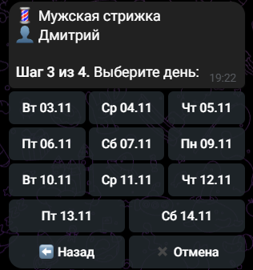
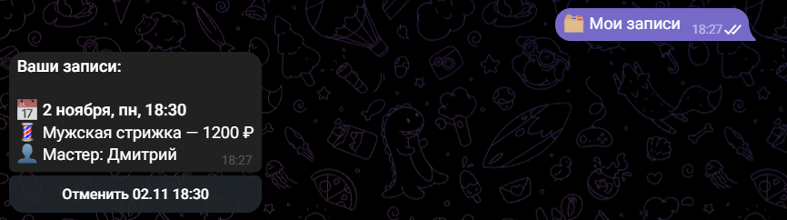

# 💈 Telegram-бот для онлайн-записи в барбершоп

Бот, через который клиенты записываются на услуги салона: выбирают услугу, мастера, день и свободное время. Администратор получает уведомления о новых записях и управляет расписанием прямо в Telegram.

> Демонстрационный проект. Легко адаптируется под салон красоты, маникюр, автосервис, репетитора, клинику — любой бизнес с записью по времени.

<p align="center">
     
     
     
   </p>
   <p align="center">
     
     
     
   </p>

## Возможности

**Для клиента**
- Пошаговая запись: услуга → мастер → день → время → имя и телефон → подтверждение
- Показываются только реально свободные окна с учётом длительности услуги и уже занятого времени
- Кнопка «Назад» на каждом шаге
- Отправка номера телефона одной кнопкой
- Раздел «Мои записи» с отменой
- Автоматическое напоминание за 2 часа до визита
- Информация о салоне и прайс

**Для администратора** (`/admin`)
- Мгновенные уведомления о новых записях и отменах
- Расписание на сегодня, завтра или любую дату
- Отмена записи с автоматическим уведомлением клиента
- Рассылка сообщений всем пользователям бота

**Надёжность**
- Защита от двойного бронирования: если два клиента одновременно выбрали одно время, запишется только первый, второму бот предложит другое
- Проверка, что выбранное время ещё не прошло
- Валидация имени и телефона

## Стек

- Python 3.10+
- [aiogram 3](https://docs.aiogram.dev/) — асинхронный фреймворк для Telegram-ботов
- SQLite + aiosqlite
- FSM (конечный автомат) для пошагового сценария записи

## Запуск

1. Создайте бота у [@BotFather](https://t.me/BotFather) и получите токен.
2. Узнайте свой Telegram id у [@userinfobot](https://t.me/userinfobot).
3. Установите зависимости и настройте окружение:

```bash
git clone <ссылка-на-репозиторий>
cd booking_bot
python -m venv venv
venv\Scripts\activate          # Windows
# source venv/bin/activate     # Linux / macOS
pip install -r requirements.txt
copy .env.example .env         # Windows (Linux/macOS: cp .env.example .env)
```

4. Впишите в `.env` токен и свой id в `ADMIN_IDS`.
5. Запустите:

```bash
python main.py
```

6. Напишите боту `/start`, а для админ-панели — `/admin`.

## Настройка под заказчика

Всё основное лежит в `settings.py`:

| Что | Где |
|---|---|
| Название, адрес, телефон | `SALON_NAME`, `SALON_ADDRESS`, `SALON_PHONE` |
| Часы и дни работы | `WORK_START`, `WORK_END`, `WORK_DAYS` |
| Шаг сетки времени | `SLOT_STEP_MIN` |
| На сколько дней вперёд запись | `DAYS_AHEAD` |
| Когда напоминать | `REMIND_BEFORE_HOURS` |
| Услуги и мастера | `DEFAULT_SERVICES`, `DEFAULT_MASTERS` (заносятся в базу при первом запуске) |

## Структура проекта

```
booking_bot/
├── main.py              # запуск бота
├── config.py            # загрузка .env
├── settings.py          # настройки салона
├── database.py          # работа с SQLite
├── keyboards.py         # кнопки и callback-данные
├── states.py            # состояния FSM
├── filters.py           # фильтр «только для админов»
├── handlers/
│   ├── user.py          # сценарий клиента
│   └── admin.py         # админ-панель
└── utils/
    ├── schedule.py      # расчёт свободного времени
    ├── formatting.py    # форматирование дат, телефонов, записей
    ├── notify.py        # уведомления администраторам
    └── reminders.py     # фоновые напоминания клиентам
```

## Возможные доработки

- Выходные и отпуска мастеров, индивидуальный график
- Управление услугами и мастерами из админ-панели
- Выгрузка записей в Google Таблицы или Excel
- Онлайн-предоплата через ЮKassa
- Хранение FSM в Redis и деплой на сервер через Docker
